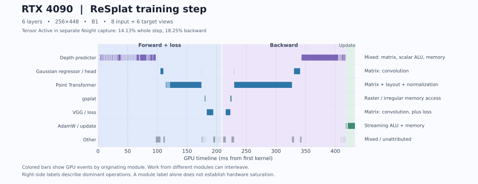

# RTX 4090 反向实测

对应 [Thor 组合版](PROFILING.md#三档已测流水)的六层 ReSplat Base 初始化负载。B1、256×448、8 个输入视角、6 个监督视角、128 个深度候选和 57,344 个高斯。保留 local KNN 候选融合、局部 attention、Point Transformer 卷积布局、BF16 感知分支和 fused AdamW。4090 使用固定 seed 随机 depth 权重和合成标定数据，Thor 的历史记录加载了官方 depth 权重。跨卡对照也包含不同 CUDA 和 PyTorch 构建的影响。

## 时延与数值

RTX 4090 使用 CUDA 12.8、PyTorch 2.10.0+cu128。每个独立训练进程先预热 3 步，再采 8 步。表中 CUDA 时间取中位数。最大 loss 差和最大抽样梯度相对 L2 均与同一基线对照，场景、输入机位和更新序号逐项相等。

| 配置 | CUDA 反向 ms | CUDA 整步 ms | 保留峰值 GiB | 最大 loss 差 | 最大抽样梯度相对 L2 |
| --- | ---: | ---: | ---: | ---: | ---: |
| 组合版基线 | 201.25 | 392.43 | 20.41 | | |
| 同配置重复 | 201.35 | 392.87 | 20.41 | 1.58e-4 | 3.27% |
| Point Transformer 重算 | 254.11 | 445.96 | 14.72 | 2.00e-4 | 4.65% |
| 所有 Conv2d 权重 channels-last | 210.15 | 403.29 | 20.43 | 1.03e-2 | 92.68% |
| cuDNN 自动选核 | 198.34 | 388.34 | 20.57 | 5.34e-4 | 21.04% |
| 所有 Conv2d 权重 channels-last + 自动选核 | 205.19 | 399.90 | 20.73 | 6.57e-3 | 65.95% |
| 启用 TF32 | 199.52 | 373.45 | 20.41 | 7.61e-4 | 36.67% |
| Cost volume D32 | 212.47 | 401.81 | 17.38 | 6.80e-4 | 6.55% |

同卡最快反向仅比基线少 2.91 ms，抽样梯度差超过基线重复跑的波动。TF32 的整步收益主要在前向。候选的统计未涉及训练收敛或留出图像质量，保留原默认组合。

## Nsight 对照

独立 capture 包含 2 个预热后的 B1 步。按 GPU phase span，Thor 反向 **852.87 ms**，4090 **202.56 ms**。观察到的跨卡倍率约 **4.21×**。4090 的整步 CUDA event timing 另见上表。

4090 反向每步平均约 3,714 个 CUDA kernels。按 kernel 名启发式汇总，通用 GEMM/GEMV 约 **47 ms**，cuDNN 卷积 **43 ms**，copy/cast/memset 类 **36 ms**，逐元素与规约 **23 ms**，归一化 **17 ms**。NCHW/NHWC 转换约 **5 ms**，Triton 局部 attention 反向 **6 ms**，grid sampler 反向 **4 ms**。这是核时长累计，存在重叠，也可能把相同名称的多个调用点合在一起。

以 4090 自己的基线为起点，反向减半约需省 101 ms。先用 Torch trace 的调用形状与 GPU kernel correlation 拆出哪些 GEMM、卷积和小算子能共享布局或融合。即使把 copy/cast/memset、逐元素/规约和归一化三类的约 76 ms 累计全部消除，也需要继续降低主要矩阵算子的耗时。

[4090 原始跑分及数值](../benchmarks/results/rtx4090/backward-ab/) · [阶段流水](../benchmarks/results/rtx4090/backward-ab/baseline-stages.json) · [Nsight 汇总](../benchmarks/results/rtx4090/backward-ab/baseline-nsys-summary.json)

## 复现

使用 [Handoff](HANDOFF.md#2-从原始速度逐级-ab) 的组合版命令。将 checkpoint 参数改成 `null`，设置 `RESPLAT_PROFILE_WARMUP=3 RESPLAT_PROFILE_SAMPLES=8 RESPLAT_PROFILE_PARAMETER_AUDIT=1`。布局实验调用 `torch.nn.utils.convert_conv2d_weight_memory_format(model_wrapper, torch.channels_last)`，选核实验设置 `torch.backends.cudnn.benchmark = True`。TF32 使用 `RESPLAT_FP32_MATMUL_PRECISION=high`。重算与 D32 分别加 `model.encoder.init_use_checkpointing=true` 和 `model.encoder.cost_volume_depth_chunk=32`。

## 反向调用点归因

同一 B1 组合版用 Torch profiler 独立采 2 个预热后的训练步。用 CUDA correlation 找到 launch，再用 autograd sequence number 关联到原前向算子和 NVTX 对应的模块。反向 CUDA event 的累计时长平均 **198.28 ms**，含 GPU memcpy/memset。以下是累计时长，子项不能加到父项之外。历史 Nsight 的 36 ms 是按 kernel 名广义筛选，这次通过调用点识别到的显式 copy/cast/搬运是 **29.30 ms**，两种筛选口径独立。

| 前向所属模块 | 反向 GPU 时间 ms | 其中 copy/cast/搬运 ms |
| --- | ---: | ---: |
| Point Transformer | 96.88 | 16.87 |
| Depth predictor（另列 eager warp） | 62.29 | 8.32 |
| Gaussian regressor | 10.22 | 1.78 |
| VGG | 7.75 | 0.01 |
| Eager cost-volume warp | 4.04 | 0.00 |
| gsplat | 1.84 | 0.03 |
| Gaussian head | 0.22 | 0.01 |
| 其他或未关联 | 15.04 | 2.28 |

Point Transformer 的热点包括：线性层的 dX/dW GEMM **23.52 ms**，其中六层 512→2048→512 的 MLP 四组 GEMM 约 **17.00 ms**。其余两块是六层多视图 512×512 的 3×3 卷积梯度 **23.38 ms**（含归到该卷积节点的布局开销），和 LayerNorm 反向 **14.09 ms**。局部 attention Triton kernel 约 **5.88 ms**。

优先对多视图布局做同 dtype 的逐位 A/B。将 pixel shuffle/unshuffle、reshape 与 channels-last 拷贝合成一次读写，避免中间布局落地。反向能明确归到两档 View 的 copy **4.57 ms**、PixelShuffle **2.87 ms**、PixelUnshuffle **0.73 ms**，合计约 **8.17 ms/步**的观测预算。其中涉及 `[1,8,16,28,8192]`、`[1,8,64,112,512]` 等实际形状。单独对卷积布局或整网换 memory format 已实测出现回退。

第二步可在同一 Point Transformer 内做 LayerNorm 输出到 BF16 GEMM、残差梯度与 MLP 周边的局部融合，保持 FP32 统计、累加和现有舍入点。重点查 `[57344,512]` 与 `[1,3584,8192]`。剩余矩阵乘要按实际 dX/dW shape 单独测。当前归因下，即使消除整个 Point Transformer 的 96.88 ms，其他反向 GPU 事件仍约 101 ms，反向减半需要多个模块一起降时延。

[调用点与张量 shape](../benchmarks/results/rtx4090/backward-ab/backward-callsite-summary.json)

## Tensor Active 与模块甘特图

Nsight Systems 2024.6.2 用 Ada `ad10x` 指标集以 10 kHz 采样。每个阶段的指标取该阶段首末 CUDA kernel 时间内的样本均值，再取四个稳态更新的中位数。整步窗口包含阶段之间的空隙，始于第一个前向 kernel，止于最后一个更新 kernel。这里的 TCU 取 `Tensor Active [Throughput %]`。[指标定义](https://docs.nvidia.com/nsight-systems/UserGuide/index.html)

| GPU 范围 | GPU span | Tensor Active | SM Active | SM Issue | DRAM 读 | DRAM 写 |
| --- | ---: | ---: | ---: | ---: | ---: | ---: |
| 前向 + loss | 189.15 ms | 10.80% | 57.12% | 8.79% | 14.83% | 17.54% |
| 反向 | 202.81 ms | **18.25%** | 89.23% | 12.58% | 27.11% | 18.77% |
| 更新 | 13.00 ms | 0.00% | 68.24% | 2.68% | 39.05% | 26.22% |
| 整步 | 406.50 ms | **14.13%** | 73.31% | 10.46% | 21.68% | 18.37% |

四个反向窗口的 Tensor Active 为 18.23–18.27%。前向内部，Point Transformer **18.13%**、Gaussian regressor **35.79%**、VGG **28.71%**、depth predictor **5.67%**、KNN **0.06%**、gsplat **0.00%**。百分比各按自身窗口采样。DRAM 读写分开报告。



甘特图取独立 Torch trace 中第一个稳态更新。前向用 CUDA launch 对应的模块标签，反向用 autograd sequence number 回到前向模块。深度采样合并进 depth predictor。相同模块间隔不到 40 µs 的活动合并展示，短于 3 µs 的孤立活动省略。图上的相对时间来自该次 Torch capture。硬件计数器来自上表的独立 Nsight capture。

模块类型依据实际算子和阶段计数器。Point Transformer 的主要时间是矩阵乘和卷积，同时有布局和归一化开销。Depth predictor 是矩阵、标量 ALU 和访存的混合。gsplat 是不规则光栅化与访存，AdamW 是流式逐元素更新。现有证据适合给模块排优先级。判定某个核是否真正达到 Tensor、ALU 或 DRAM 上限需要逐核数据。[Nsight Compute Roofline](https://docs.nvidia.com/nsight-compute/ProfilingGuide/index.html)

[四次采样及各阶段指标](../benchmarks/results/rtx4090/backward-ab/gpu-metrics.json) · [甘特图时间数据](../benchmarks/results/rtx4090/backward-ab/module-timeline.json)

```bash
uv run --with matplotlib python benchmarks/plot_module_gantt.py \
  benchmarks/results/rtx4090/backward-ab/module-timeline.json \
  docs/assets/rtx4090-module-gantt.svg \
  --metrics benchmarks/results/rtx4090/backward-ab/gpu-metrics.json
```
